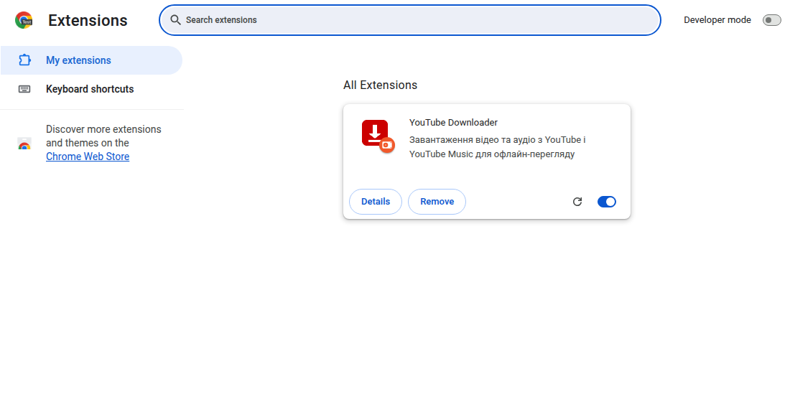
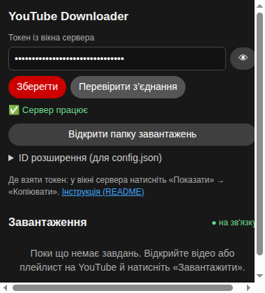
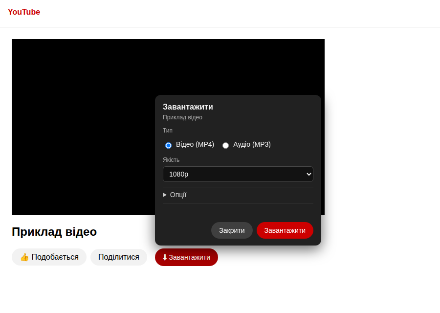
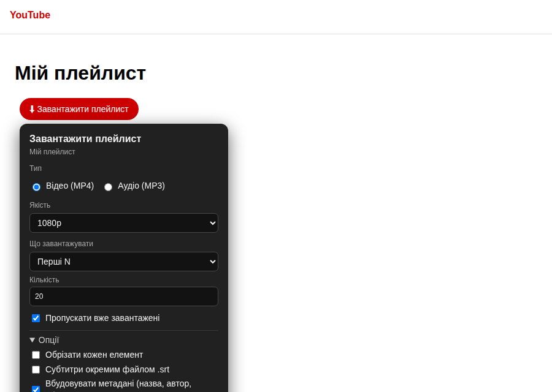
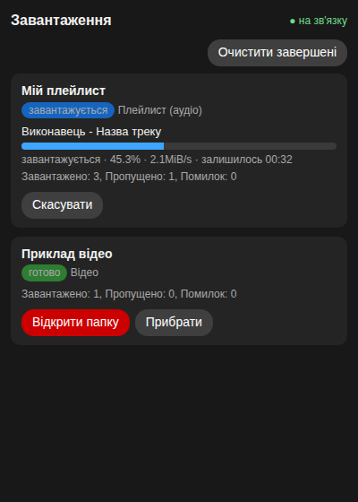

# YouTube Downloader

Програма для Windows, яка завантажує відео (MP4) та аудіо (MP3) з YouTube і YouTube Music прямо з кнопки на сторінці браузера — для офлайн-перегляду.

## Що потрібно

- Windows 10 або 11
- браузер Google Chrome
- інтернет (для встановлення і завантаження)

Python, FFmpeg і Deno інсталятор поставить сам (він запитає дозвіл).

## Встановлення

### Крок 1. Запустіть інсталятор

1. Розпакуйте папку з програмою в зручне місце, наприклад `C:\YouTubeDownloader`. Не запускайте інсталятор із ZIP-архіву, спочатку розпакуйте його.
2. Двічі клацніть `install.bat`. Якщо щось не виходить — правою кнопкою → **«Запуск від імені адміністратора»**.
3. Дочекайтеся завершення. Якщо інсталятор поставив Python, FFmpeg або Deno, він попросить закрити вікно й запустити `install.bat` ще раз. Це нормально: Windows має оновити налаштування. Повторний запуск нічого не ламає.

Наприкінці відкриється папка `extension` і ця інструкція, а також вікно сервера з токеном.

### Крок 2. Встановіть розширення в Chrome

1. Відкрийте в Chrome адресу `chrome://extensions`.
2. Увімкніть **«Режим розробника»** (перемикач угорі праворуч).
3. Натисніть **«Завантажити розпаковане»** і виберіть папку `extension` із папки програми.

   

   *(Скриншот зроблено в англійському Chrome. У вашому інтерфейсі написи будуть українською.)*

4. На картці розширення знайдіть **ID** (рядок із 32 літер) і скопіюйте його. Його також видно в налаштуваннях розширення, у розділі «ID розширення».
5. Відкрийте файл `config.json` у Блокноті й вставте ID в поле `allowed_extension_ids`:

   ```json
   "allowed_extension_ids": ["abcdefghijklmnopabcdefghijklmnop"]
   ```

6. Перезапустіть сервер: у вікні сервера натисніть **«Зупинити сервер»**, потім **«Запустити сервер»**.
7. Натисніть значок розширення в панелі Chrome, вставте **токен** із вікна сервера (кнопки «Показати» / «Копіювати») і натисніть **«Зберегти»**.
8. Натисніть **«Перевірити з’єднання»**. Має з’явитися **«✅ Сервер працює»**.

   

## Як користуватися

### Одне відео

Відкрийте відео на YouTube → кнопка **«⬇ Завантажити»** → оберіть тип (відео MP4 / аудіо MP3) і якість → **«Завантажити»**.



У розділі «Опції» можна обрізати фрагмент, зберегти субтитри окремим файлом `.srt`, вбудувати метадані й вирівняти гучність.

### Плейлист

Відкрийте плейлист → кнопка **«⬇ Завантажити плейлист»** → оберіть тип і якість, за потреби — «Перші N» або діапазон → **«Завантажити»**. Уже завантажені файли пропускаються.



### Прогрес

Прогрес показує бічна панель розширення: смуга, швидкість, залишок часу. Кожне завдання можна скасувати. Після завершення з’явиться підсумок («Завантажено / Пропущено / Помилок») і кнопка **«Відкрити папку»**.



Якщо обраної якості в відео немає, розширення запропонує доступні варіанти.

## Де шукати файли

Усе лежить у папці програми:

```text
YouTubeDownloader\
├── завантажені відео\
│   ├── Назва відео.mp4
│   └── Назва плейлиста\
│       └── Назва відео.mp4
├── завантажені аудіо\
│   ├── Виконавець - Назва.mp3
│   └── Назва плейлиста\
│       └── Виконавець - Назва.mp3
├── config.json        налаштування
├── downloaded.txt     що вже завантажено
├── failed.txt         що не вдалося і чому
└── log.txt            докладний журнал
```

Кнопка **«Відкрити папку»** в розширенні відкриває потрібну папку у Провіднику.

Сервер без розширення теж можна використовувати. Запустіть `youtube_downloader.py` з консолі або вставте посилання у вікні сервера.

## Що робити, якщо…

**«Сервер недоступний».** Перевірте, чи запущено `youtube_downloader.py`: він має працювати у фоні (значок у треї, біля годинника). Запустіть його ярликом з папки автозапуску або командою `pythonw youtube_downloader.py`.

**Розширення пише «Сервер не дозволив це розширення».** ID розширення не додано до `allowed_extension_ids` у `config.json`, або сервер не перезапущено після цього (див. крок 2.5–2.6).

**«Невірний токен».** Скопіюйте токен із вікна сервера ще раз і збережіть у налаштуваннях розширення.

**«Помилка 403 / 429».** YouTube тимчасово обмежує запити. Сервер сам зробить паузу й повторить спробу. Також:
- оновіть yt-dlp: у вікні сервера натисніть **«Оновити yt-dlp»**;
- переконайтеся, що cookies передаються: у браузері має бути відкрита вкладка YouTube, і ви маєте бути в ній увійшли в акаунт.

**«Не вдається завантажити конкретне відео».** Перегляньте `log.txt` і `failed.txt`. Часті причини: відео приватне, видалене, має вікове обмеження або недоступне у вашому регіоні.

**Не вистачає місця на диску.** Для плейлиста розширення покаже попередження і запропонує продовжити або скасувати.

## Видалення

Запустіть `uninstall.bat`. Він зупинить сервер, прибере автозапуск і запитає, чи видаляти бібліотеки Python. Ваші завантажені файли, `config.json`, `downloaded.txt` і `log.txt` **не видаляються**. Інсталятор лише покаже, де вони лежать. Саме розширення видаліть на сторінці `chrome://extensions`.

## Ліцензія та правове застереження

Завантажуйте лише відео, на які ви маєте право: власні, під ліцензією Creative Commons або з дозволу автора. Дотримуйтесь [Умов використання YouTube](https://www.youtube.com/t/terms) та законодавства вашої країни. Автори програми не несуть відповідальності за її використання.
